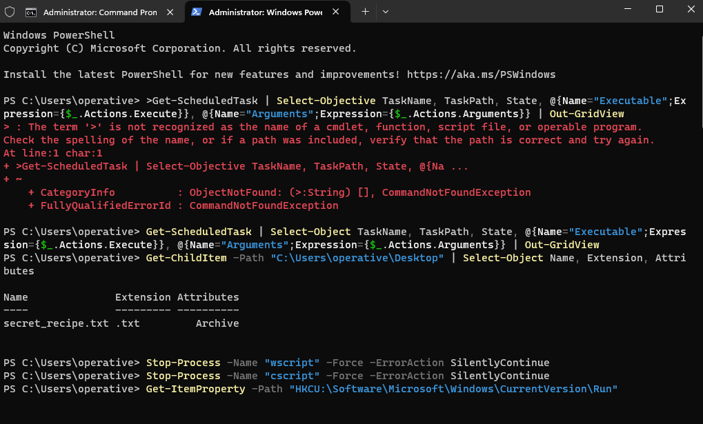
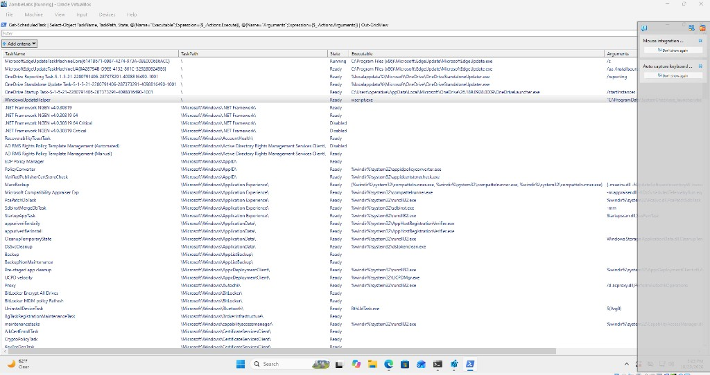
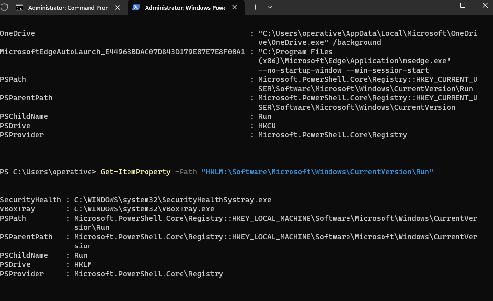
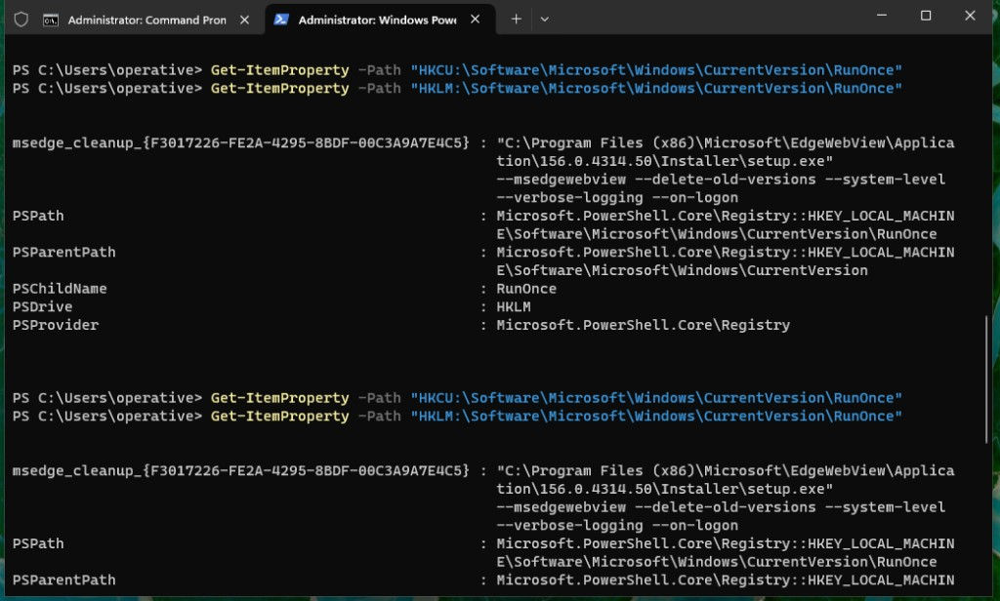
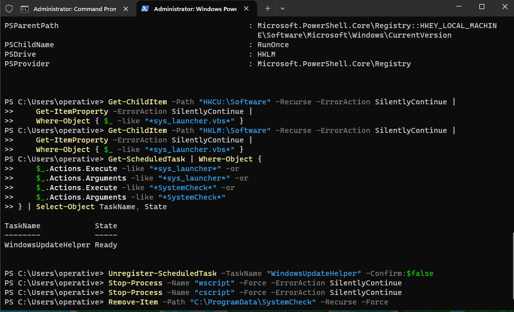

# Persistence That Survives a Process Kill

Incident response notes from an isolated Windows lab. A file on the desktop stayed locked because a script host had it open. Killing the process released the file. After reboot the lock was back. The process that returned was started by a scheduled task named `WindowsUpdateHelper`, whose action was `wscript.exe` executing `C:\ProgramData\SystemCheck\sys_launcher.vbs`.

The lab calls this the zombie effect: the visible process dies, and the autostart brings it back. This write-up follows the session in the order it was worked: task inventory, desktop artifact, script-host termination, `Run` and `RunOnce`, a registry search for the script path, the task that the registry search missed, and the removal.

## Summary

| Item | Detail |
| --- | --- |
| Host | Windows guest in VirtualBox, local account `operative` |
| Session | Elevated PowerShell |
| Symptom | `secret_recipe.txt` on the desktop held open by another process |
| Launcher | `C:\ProgramData\SystemCheck\sys_launcher.vbs` |
| Process | `wscript.exe` ( `cscript.exe` stopped in the same step ) |
| Persistence | Scheduled task `WindowsUpdateHelper`, state `Ready`, path `\` |
| Registry | HKCU and HKLM `Run` and `RunOnce` did not reference the script |
| Removal | Unregister the task, stop the script hosts, delete `C:\ProgramData\SystemCheck` |

## Environment

The investigation ran inside a Windows virtual machine in VirtualBox, on a lab image built for this exercise. The guest account was `operative`. Queries were run from an elevated PowerShell window on that guest.

The guest is the right place for this work. A scheduled task and a registry change are easy to mis-edit, and a mechanism that relaunches itself does not belong on an install that also holds real accounts and files. The VM can be reverted. The daily driver cannot.

Windows setup on the guest was already finished when this session started. After sign-in, the desktop contained `secret_recipe.txt`. The lab condition was a sharing violation: the file could not be opened or deleted because another process owned a handle to it. Ending that process cleared the handle. A reboot created the process again. Finding the autostart, and removing the autostart together with the script, is what closes the case.

## Investigation

### 1. Task inventory, the desktop file, and the script host

A file lock that returns after reboot is a common shape for a logon or startup task, so Task Scheduler was the first query. Every task was selected with its name, path, and state, and the action was expanded into executable and arguments. `Out-GridView` was used so the list could be filtered.

The first attempt failed. The command was pasted with the PowerShell prompt character still attached. PowerShell treated `>` as the program name and returned `CommandNotFoundException`. The same pipeline was run again without that character, and the grid opened.

```powershell
Get-ScheduledTask | Select-Object TaskName, TaskPath, State, @{Name="Executable";Expression={$_.Actions.Execute}}, @{Name="Arguments";Expression={$_.Actions.Arguments}} | Out-GridView
```

The desktop was listed next, to confirm the file from the report:

```powershell
Get-ChildItem -Path "C:\Users\operative\Desktop" | Select-Object Name, Extension, Attributes
```

`secret_recipe.txt` was the only file. The attribute was `Archive`.

A `.vbs` launcher runs under the Windows script host. Both host processes were stopped so the handle on the recipe file would drop:

```powershell
Stop-Process -Name "wscript" -Force -ErrorAction SilentlyContinue
Stop-Process -Name "cscript" -Force -ErrorAction SilentlyContinue
```

That release is temporary. The task that created the process is still registered, so the next logon starts `wscript.exe` again and the file locks again.



*Figure 1. Elevated PowerShell on the lab guest. The pasted prompt character fails, the corrected task query runs, the desktop listing shows `secret_recipe.txt`, and `wscript` and `cscript` are stopped.*

`Out-GridView` snapshots the pipeline at the moment it runs. The window below is that snapshot. It stayed open through the rest of the session, which is why the capture sits later on the clock than the command. Task name is a weak column on its own. `WindowsUpdateHelper` reads like an operating system component until Executable and Arguments are visible: `wscript.exe`, and a script under `C:\ProgramData\SystemCheck`.



*Figure 2. Scheduled tasks with executable and arguments expanded. Built-in Windows tasks fill most of the grid. Filtering this view for `vbs` or `SystemCheck` separates the launcher from that list. The console filter in Figure 5 printed the match as text: `WindowsUpdateHelper`, state `Ready`.*

### 2. Run keys

The four standard autostart keys were still enumerated. A second mechanism under `Run` would survive deletion of the scheduled task.

```powershell
Get-ItemProperty -Path "HKCU:\Software\Microsoft\Windows\CurrentVersion\Run"
Get-ItemProperty -Path "HKLM:\Software\Microsoft\Windows\CurrentVersion\Run"
```

HKCU `Run` had two values, both consistent with software installed on the guest:

| Name | Data |
| --- | --- |
| `OneDrive` | `"C:\Users\operative\AppData\Local\Microsoft\OneDrive\OneDrive.exe" /background` |
| `MicrosoftEdgeAutoLaunch_E44968BDAC07D843D179E87E7E8F00A1` | `"C:\Program Files (x86)\Microsoft\Edge\Application\msedge.exe" --no-startup-window --win-session-start` |

HKLM `Run` had two values:

| Name | Data |
| --- | --- |
| `SecurityHealth` | `C:\WINDOWS\system32\SecurityHealthSystray.exe` |
| `VBoxTray` | `C:\WINDOWS\system32\VBoxTray.exe` |

`VBoxTray` belongs on a VirtualBox guest. None of these values reference `sys_launcher.vbs` or `C:\ProgramData\SystemCheck`.



*Figure 3. HKCU and HKLM `Run`. OneDrive, Edge autolaunch, Windows Security systray, and the VirtualBox tray.*

### 3. RunOnce keys

`RunOnce` values execute and are then removed. They are a weak long-term autostart, and they were read so a one-shot relaunch would be seen if it was there.

```powershell
Get-ItemProperty -Path "HKCU:\Software\Microsoft\Windows\CurrentVersion\RunOnce"
Get-ItemProperty -Path "HKLM:\Software\Microsoft\Windows\CurrentVersion\RunOnce"
```

HKCU `RunOnce` had no values.

HKLM `RunOnce` had one value:

| Name | Data |
| --- | --- |
| `msedge_cleanup_{F3017226-FE2A-4295-8BDF-00C3A9A7E4C5}` | `"C:\Program Files (x86)\Microsoft\EdgeWebView\Application\156.0.4314.50\Installer\setup.exe" --msedgewebview --delete-old-versions --system-level --verbose-logging --on-logon` |

That command is the Edge WebView installer removing an older version at logon. The path, the `msedgewebview` switch, and the versioned installer directory match a normal Edge update leftover. It does not point at `SystemCheck`. The same two queries were run again and returned the same Edge value. The Edge entry was left in place.



*Figure 4. `RunOnce` under HKCU and HKLM. The only value is Edge WebView cleanup, `msedge_cleanup_...`, calling `setup.exe` with `--delete-old-versions`.*

### 4. Searching the registry for the script path

A launcher can live outside the four well-known keys. `HKCU:\Software` and `HKLM:\Software` were walked, and any property whose data contained `sys_launcher.vbs` was kept.

```powershell
Get-ChildItem -Path "HKCU:\Software" -Recurse -ErrorAction SilentlyContinue |
  Get-ItemProperty -ErrorAction SilentlyContinue |
  Where-Object { $_ -like "*sys_launcher.vbs*" }

Get-ChildItem -Path "HKLM:\Software" -Recurse -ErrorAction SilentlyContinue |
  Get-ItemProperty -ErrorAction SilentlyContinue |
  Where-Object { $_ -like "*sys_launcher.vbs*" }
```

Both pipelines returned no objects. The script path was not stored in those trees.

### 5. The scheduled task

The task list was then filtered on the two strings already tied to the case: the script name, and the directory name.

```powershell
Get-ScheduledTask | Where-Object {
  $_.Actions.Execute -like "*sys_launcher*" -or
  $_.Actions.Arguments -like "*sys_launcher*" -or
  $_.Actions.Execute -like "*SystemCheck*" -or
  $_.Actions.Arguments -like "*SystemCheck*"
} | Select-Object TaskName, State
```

One task matched.

| TaskName | State |
| --- | --- |
| `WindowsUpdateHelper` | `Ready` |

`Ready` means the task is registered and waiting for its trigger. With the action columns from the grid, the persistence is:

| Field | Value |
| --- | --- |
| Task name | `WindowsUpdateHelper` |
| Task path | `\` |
| Executable | `wscript.exe` |
| Arguments | `C:\ProgramData\SystemCheck\sys_launcher.vbs` |

The name borrows a Windows Update label. The binary is a Windows component used as a script host. The script sits in `C:\ProgramData`, which is shared, writable by a standard user, and easy to skip when the user profile is the first place checked.

## Eradication

Three layers had to be removed, in an order that accounts for the file handle.

Deleting the script while `wscript.exe` has it open fails with a file-in-use error. Deleting the script and leaving the task means the next trigger starts a host that no longer has a script, and the autostart is still present. Unregistering the task and leaving the directory leaves the payload on disk.

1. Unregister `WindowsUpdateHelper` so the trigger is gone.
2. Stop `wscript.exe` and `cscript.exe` so the handle is gone.
3. Delete `C:\ProgramData\SystemCheck`, including `sys_launcher.vbs`.

```powershell
Unregister-ScheduledTask -TaskName "WindowsUpdateHelper" -Confirm:$false

Stop-Process -Name "wscript" -Force -ErrorAction SilentlyContinue
Stop-Process -Name "cscript" -Force -ErrorAction SilentlyContinue

Remove-Item -Path "C:\ProgramData\SystemCheck" -Recurse -Force
```

`-Confirm:$false` skips the prompt on `Unregister-ScheduledTask`. `-ErrorAction SilentlyContinue` on `Stop-Process` covers a host that is already gone. `-Recurse -Force` removes the directory when a child is hidden or read-only.

The three commands were entered in that order. The session showed no error from any of them.



*Figure 5. The registry search for `sys_launcher.vbs` returns nothing. The task filter returns `WindowsUpdateHelper` in the `Ready` state. The task is unregistered, both script hosts are stopped, and `C:\ProgramData\SystemCheck` is deleted.*

## Close-out

The removal commands returned no errors. A host is clean after the autostart is gone across a reboot, because a second trigger only shows up at the next logon. These are the checks for that pass:

```powershell
Get-ScheduledTask -TaskName "WindowsUpdateHelper" -ErrorAction SilentlyContinue
Test-Path "C:\ProgramData\SystemCheck"
Get-Process wscript, cscript -ErrorAction SilentlyContinue
```

After a successful removal the task lookup returns nothing, `Test-Path` is `False`, and neither script host is running. Reboot, sign in, wait for startup items, and open `secret_recipe.txt`. The file should open, and the three checks should stay empty.

## Findings

`Run` held OneDrive, Edge, Windows Security, and the VirtualBox guest tray. `RunOnce` held one Edge WebView cleanup command. A recursive search of `Software` under HKCU and HKLM for `sys_launcher.vbs` returned nothing.

The autostart was Task Scheduler. `WindowsUpdateHelper` was enabled and ready. Its action was `wscript.exe` executing `C:\ProgramData\SystemCheck\sys_launcher.vbs`. Stopping the script host cleared the lock on `secret_recipe.txt` until the task ran again. Unregistering the task, stopping the host, and deleting the script directory removes the mechanism.

## Takeaways

- The task name is part of the disguise. `WindowsUpdateHelper` sits in a list of real Windows tasks until the action is expanded.
- `Get-ScheduledTask` without the action hides the indicator. Executable and arguments are the columns that turned the name into a script path under `ProgramData`.
- `C:\ProgramData` is a common staging directory: shared, writable, and outside the profile that gets checked first.
- A file-in-use error on delete is a handle problem. The handle belonged to the script host. The scheduled task is why the handle came back.
- Legitimate leftovers still show up in autostart locations. The Edge WebView `RunOnce` value stayed, because its path and switches matched an Edge installer cleanup.
- A pasted console prompt is enough to waste a query. The leading `>` was parsed as the program name.

## Commands

In the order they were used.

```powershell
# Task inventory with the action expanded
Get-ScheduledTask | Select-Object TaskName, TaskPath, State, @{Name="Executable";Expression={$_.Actions.Execute}}, @{Name="Arguments";Expression={$_.Actions.Arguments}} | Out-GridView

# Desktop artifact
Get-ChildItem -Path "C:\Users\operative\Desktop" | Select-Object Name, Extension, Attributes

# Release the file handle
Stop-Process -Name "wscript" -Force -ErrorAction SilentlyContinue
Stop-Process -Name "cscript" -Force -ErrorAction SilentlyContinue

# Standard autostart keys
Get-ItemProperty -Path "HKCU:\Software\Microsoft\Windows\CurrentVersion\Run"
Get-ItemProperty -Path "HKLM:\Software\Microsoft\Windows\CurrentVersion\Run"
Get-ItemProperty -Path "HKCU:\Software\Microsoft\Windows\CurrentVersion\RunOnce"
Get-ItemProperty -Path "HKLM:\Software\Microsoft\Windows\CurrentVersion\RunOnce"

# Script path under the Software trees
Get-ChildItem -Path "HKCU:\Software" -Recurse -ErrorAction SilentlyContinue | Get-ItemProperty -ErrorAction SilentlyContinue | Where-Object { $_ -like "*sys_launcher.vbs*" }
Get-ChildItem -Path "HKLM:\Software" -Recurse -ErrorAction SilentlyContinue | Get-ItemProperty -ErrorAction SilentlyContinue | Where-Object { $_ -like "*sys_launcher.vbs*" }

# Task whose action references the launcher
Get-ScheduledTask | Where-Object {
  $_.Actions.Execute -like "*sys_launcher*" -or
  $_.Actions.Arguments -like "*sys_launcher*" -or
  $_.Actions.Execute -like "*SystemCheck*" -or
  $_.Actions.Arguments -like "*SystemCheck*"
} | Select-Object TaskName, State

# Remove the task, the handle, and the script directory
Unregister-ScheduledTask -TaskName "WindowsUpdateHelper" -Confirm:$false
Stop-Process -Name "wscript" -Force -ErrorAction SilentlyContinue
Stop-Process -Name "cscript" -Force -ErrorAction SilentlyContinue
Remove-Item -Path "C:\ProgramData\SystemCheck" -Recurse -Force
```
